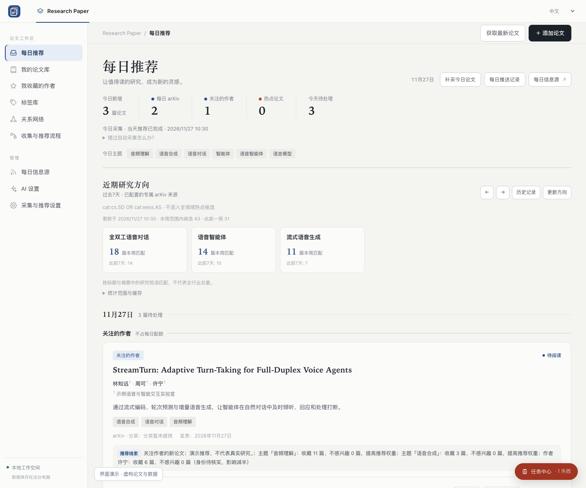
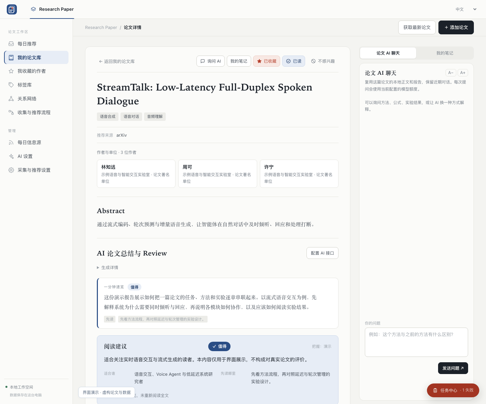
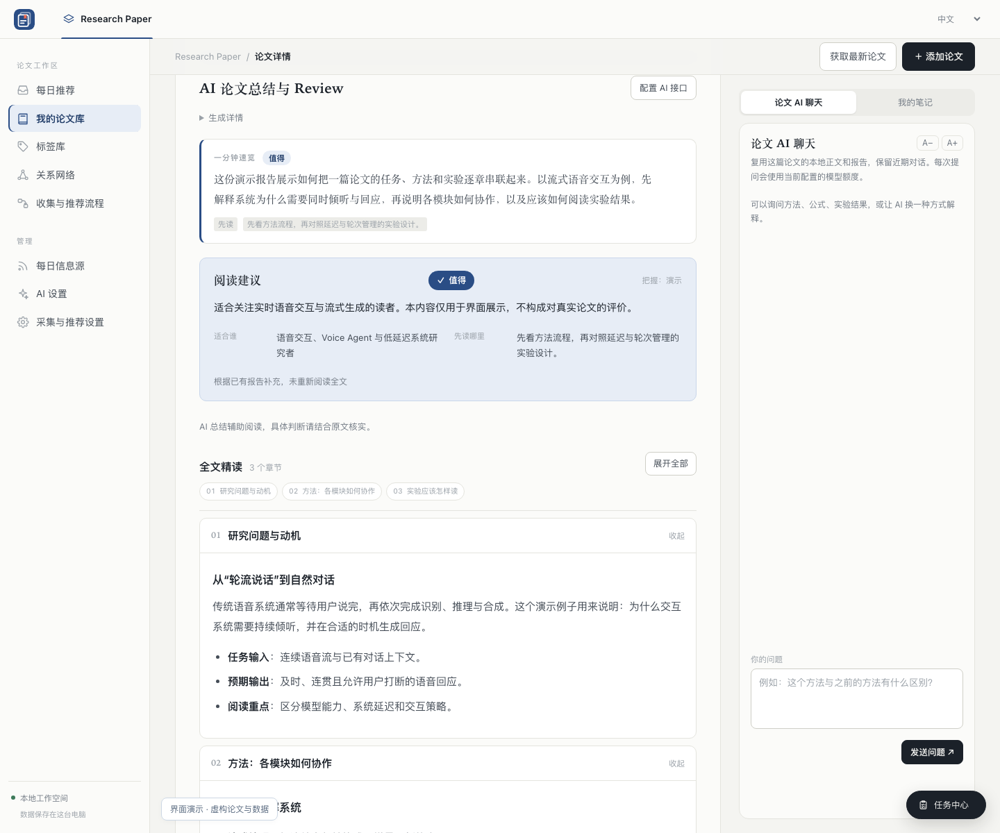
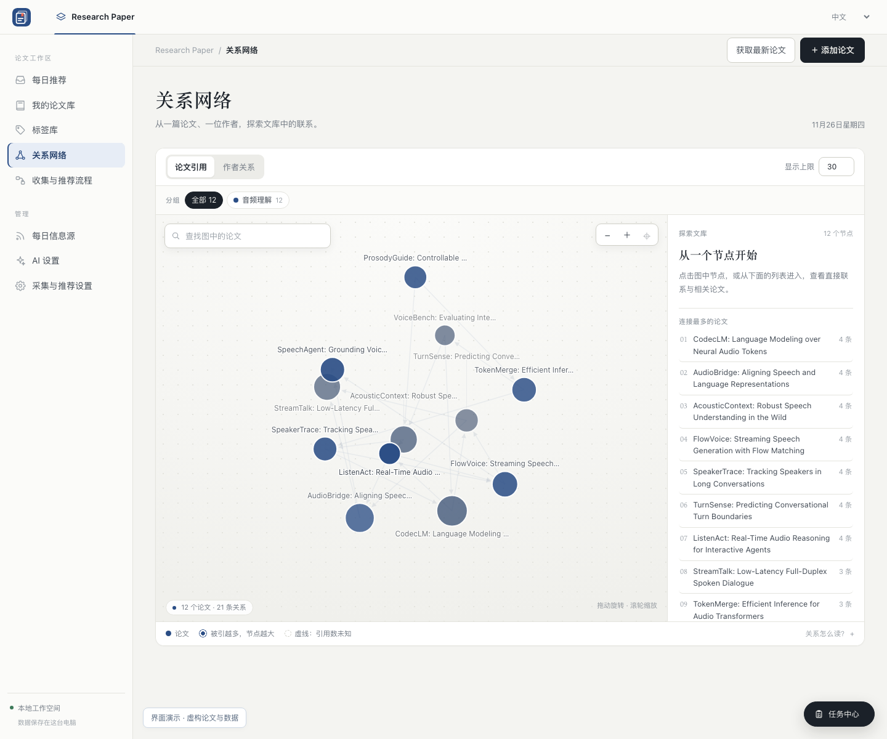

# Research Paper

把每天发现的论文，整理成自己的研究知识库。

Research Paper 是一个本地运行的论文工作台：从每日推荐开始，收藏值得读的论文，结合 AI 精读与笔记理解内容，再通过引用关系和作者网络串联研究线索。

**每日推荐 · 论文库 · AI 精读 · 论文笔记 · 引用与作者关系**

[功能展示](#功能展示) · [本地启动](#本地启动) · [首次配置](#首次配置) · [数据与安全](#数据与安全)

## 功能展示

> 以下是当前独立版实际运行的页面截图。为保护隐私，论文、作者、引用量、研究方向统计及报告内容均使用虚构演示数据，不代表真实研究结果或推荐。首次安装得到的是空白论文库。点击图片可以查看大图。

### 每日推荐：先知道今天读什么

查看当天新增论文、待处理数量和近期研究方向。每张论文卡片保留摘要、作者、主题及推荐线索，可以直接进入详情、收藏、标记已读或选择不感兴趣；错过自动采集时，也可以手动补采。

[](docs/screenshots/daily-recommendations.png)

### 我的论文库：把收藏变成可检索的积累

已收藏或已读的论文集中保存在文库中。通过搜索、标签、作者、收藏文件夹和排序定位内容，也可以直接上传 PDF 或添加论文链接。

[](docs/screenshots/paper-library.png)

### 论文详情：摘要、作者和阅读操作放在一起

点开论文卡片，即可查看标题、主题、推荐来源、作者单位和摘要，并进入 AI 精读。右侧提供论文问答与个人笔记，方便一边阅读，一边记录疑问和想法。

[](docs/screenshots/paper-detail.png)

### AI 精读：从速览到逐章理解

先用“一分钟速览”和阅读建议判断关注重点，再按章节阅读研究动机、方法及实验。支持中英文内容；当原文图表被成功提取并与讲解匹配时，可以结合图表阅读。具体结论仍需核对原文。

下图展示报告的速览、阅读建议和章节阅读界面；其中的文字为演示内容，并非真实模型评审结果。

[](docs/screenshots/ai-review.png)

### 论文引用网络：沿着连线找研究脉络

在文库中探索论文之间已有的引用关系。论文节点大小反映获取到的引用量，点击节点可查看相关论文；支持拖动、缩放和调整显示数量。引用量与连线取决于实际取得的数据，未获取到关系的论文不会自动补造连线。

[](docs/screenshots/paper-connections.png)

### 作者关系网络：发现反复出现的研究者

切换到“作者关系”，从文库论文中的共同署名探索合作网络。作者在文库中出现的论文越多，节点越大；点开节点可以继续查看相关论文。

[](docs/screenshots/author-connections.png)

---

## 本地启动

需要 Python 3.12 或更新版本。此版本在 macOS 上验证；Windows 和 Linux 尚未完成系统验收。

下载仓库 ZIP 并解压后进入项目目录；也可以先克隆仓库：

```sh
git clone https://github.com/mrjunjieli/Research-Paper.git
cd Research-Paper
```

然后安装依赖并启动：

```sh
python3 -m venv .venv
source .venv/bin/activate
python -m pip install -r requirements.txt
python server.py
```

打开 **http://127.0.0.1:8769/research**。关闭终端中的服务进程后，网站会停止运行。

Windows 使用 `py -3 -m venv .venv` 创建环境，使用 `.venv\Scripts\activate` 激活。Windows / Linux 上请使用下述环境变量提供主模型密钥；当前页面中的密钥持久化依赖 macOS 钥匙串，不支持这两个系统。

## 首次配置

1. 打开“AI 设置”，填写自己的 API 地址、模型名称和密钥，并测试连接。页面提供的模型名称只是预设，请以自己账号实际可用的模型为准。
2. 打开“每日信息源”，检查和调整来源及查询。默认包含三个来源：arXiv（`cat:cs.SD OR cat:eess.AS`）、Hugging Face Daily Papers 和 alphaXiv。后两个属于热点来源，不混入语音专属研究方向的候选统计；可按需暂停、删除或调整来源。
3. 设置兴趣主题，手动采集一次，或导入一篇论文。AI 初审、精读及作者补全会使用你配置的服务商额度。
4. 如需每天采集，再启用自动采集并设置时间。电脑必须保持唤醒，且 Python 服务持续运行。

旧版如果只显示 arXiv 和 alphaXiv，更新代码并重启服务后会一次性补齐 Hugging Face；已有的 Hugging Face 配置和暂停状态会保留，之后手动删除也不会每次启动都重新添加。

没有 API 密钥也可以启动空白工作台；AI 功能需要自行配置。本项目不附带任何作者的账号或 API 额度。

高级用户可通过 `SUMMARY_API_KEY`、`SUMMARY_BASE_URL`、`SUMMARY_MODEL` 环境变量配置主模型。这些环境变量优先于页面配置。不要把真实密钥写入仓库或提交记录；也不要把密钥填写到 API 地址中。

## 数据与安全

- 首次启动会创建全新的 `data/`，论文、笔记、PDF 和数据库保存在本机，已被 `.gitignore` 排除。
- 本源码包不包含个人数据库、论文、笔记、聊天记录、密钥或历史 Git 提交。
- macOS 页面保存的密钥存入钥匙串，配置文件仅保存引用。环境变量提供的密钥不会自动保存到配置文件。
- 服务只监听 `127.0.0.1`，供本机访问。不要直接作为公开网站部署。
- GitHub 用于分发源码，不会替你运行 Python，也不会让关机后的电脑继续采集。
- 可以用 `KNOWLEDGE_DATA_DIR` 指定独立数据目录，用 `PORT` 更改端口。

## 目录

```text
server.py                  独立启动入口
requirements.txt           PDF 处理依赖
core/deskcore/             共用服务、AI、PDF、界面资源与提示词
projects/research/         论文模块、路由与独立页面
docs/screenshots/          README 功能展示截图
tests/                    隔离的启动和隐私检查
data/                     首次运行生成，不应上传
```

不要只上传 HTML 或 `projects/research/`：运行还需要 `core/`、PDF 依赖和启动入口。接手此仓库的 AI 应先阅读本文件，使用临时数据目录测试，避免写入使用者已有论文库，也不要在未说明的情况下调用付费 API。

## 检查

```sh
python -m unittest discover -s tests -v
```

这些检查不调用付费 AI，不下载远程论文；真实采集、模型调用和第三方可用性需在配置后单独验证。

## 许可证

项目采用 [Apache License 2.0](LICENSE)。第三方资源保留各自的许可证与声明。

## 第三方资源

KaTeX 的许可证位于 `core/deskcore/static/katex/LICENSE`。Marked 的 MIT 声明保留在 `core/deskcore/static/marked.js` 中。
