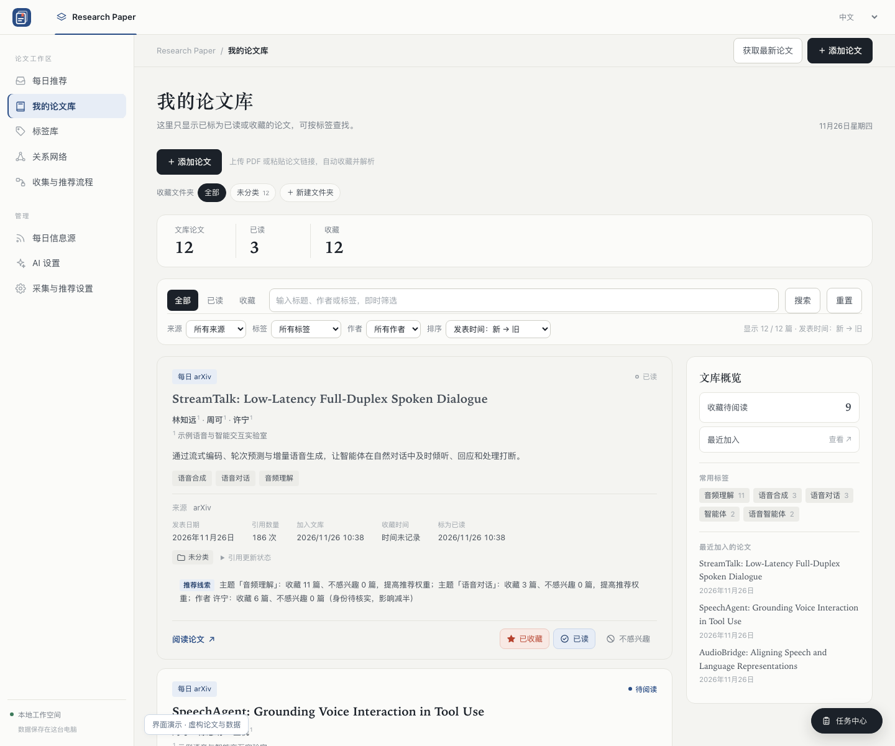
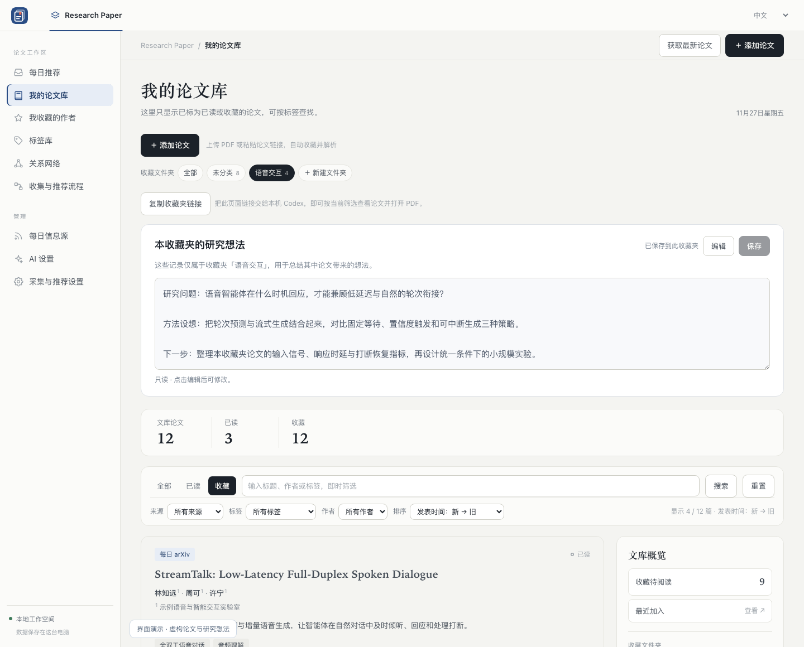
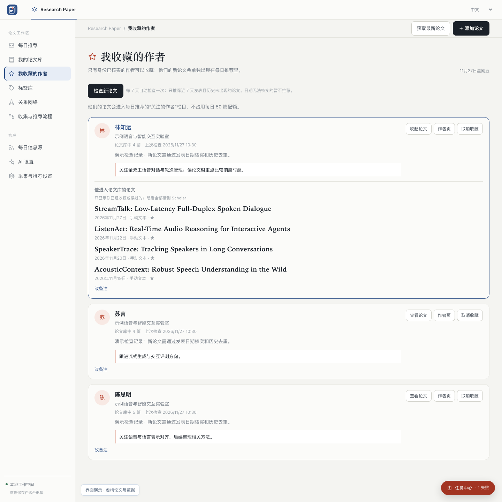
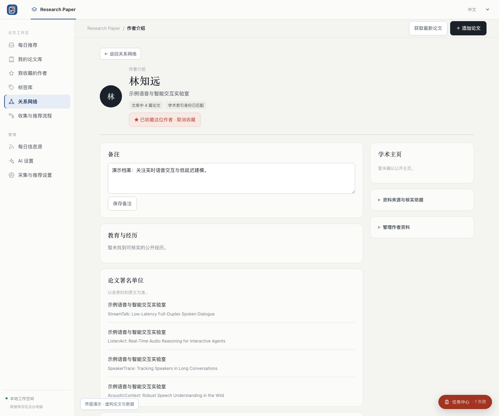
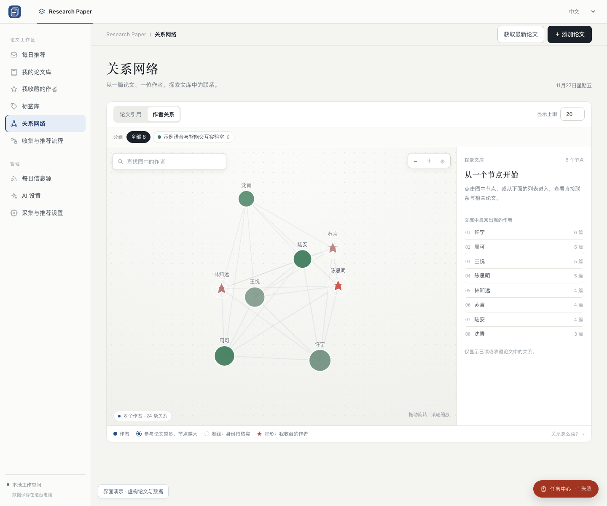
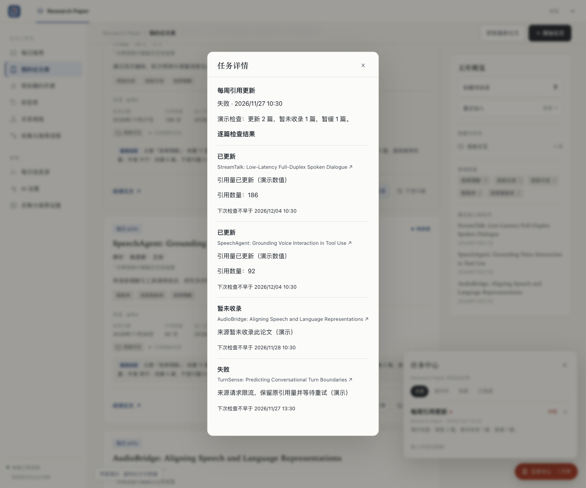

# Research Paper

把每天发现的论文，整理成自己的研究知识库。

Research Paper 是一个本地运行的论文工作台：从每日推荐开始，收藏值得读的论文，结合 AI 精读与笔记理解内容，再通过引用关系和作者网络串联研究线索。还可以收藏持续关注的研究者，在“我收藏的作者”页面集中查看作者备注、文库论文和新论文检查状态。

**每日推荐 · 我的论文库与研究想法 · 我收藏的作者 · AI 精读与笔记 · 关系网络 · 任务详情**

[一、系统介绍](#一系统介绍) · [二、安装与个性化配置](#二安装与个性化配置)

## 一、系统介绍

### 页面一览

| 页面 | 可以做什么 |
| --- | --- |
| 每日推荐 | 查看新论文、近期研究方向，以及关注作者的新论文 |
| 我的论文库 | 收藏与分类、按条件筛选、复制收藏夹链接、记录收藏夹专属研究想法 |
| 我收藏的作者 | 管理关注的研究者、写备注、查看文库中他们的论文、检查新论文 |
| 作者档案 | 核实作者身份、维护资料、收藏或取消收藏作者 |
| 论文详情与 AI 精读 | 阅读逐章讲解、查看原文、提问与记录笔记 |
| 关系网络 | 探索论文引用和作者合作关系 |
| 任务中心 | 查看后台进度，点击任务查看逐篇结果、失败原因和重试时间 |

### 功能展示

> 以下是当前独立版实际运行的页面截图。为保护隐私，论文、作者、引用量、研究方向统计及报告内容均使用虚构演示数据，不代表真实研究结果或推荐。截图已按 2026-11-27 的独立版重新拍摄，新增作者收藏、作者档案和任务详情展示。首次安装得到的是空白论文库。点击图片可以查看大图。

### 每日推荐：先知道今天读什么

查看当天新增论文、待处理数量和近期研究方向。每张论文卡片保留摘要、作者、主题及推荐线索，可以直接进入详情、收藏、标记已读或选择不感兴趣；错过自动采集时，也可以手动补采。关注作者的新论文会显示在单独的“关注的作者”栏目，使用独立配额，并与每日 arXiv、热点和历史记录统一去重。

[](docs/screenshots/daily-recommendations.png)

### 我的论文库：把收藏变成可检索的积累

已收藏或已读的论文集中保存在文库中。通过搜索、标签、作者、收藏文件夹和排序定位内容，也可以直接上传 PDF 或添加论文链接。选择文件夹后，网址会保留当前筛选；点击“复制收藏夹链接”，即可重新打开同一组论文，或交给同机且有本地访问权限的 AI 辅助阅读。刷新或从论文详情返回时，筛选条件仍然保留。

[](docs/screenshots/paper-library.png)

### 收藏夹研究想法：把阅读后的想法留在对应主题下

选中某个具体收藏夹，会出现“本收藏夹的研究想法”。可记录研究问题、方法设想、论文之间的联系，或粘贴 Codex 等工具整理的想法；“全部”和“未分类”不显示此区域。记录按收藏夹独立保存，即使收藏夹改名，也能保留原记录。

默认只读，点击 **编辑** 后输入，点击 **保存** 并保存成功后重新锁定，避免误触。编辑时仍自动保存草稿，支持多步撤销与重做（Mac：⌘Z / ⌘⇧Z；Windows/Linux：Ctrl+Z / Ctrl+Shift+Z）。退出编辑后清空撤销历史，已保存内容保留。

网络中断时会保留浏览器中的未保存草稿；多个页面同时修改时会提示冲突，避免静默覆盖。记录保存在本地数据库，不会因为使用此功能自动调用 AI 或发送给模型服务。

[](docs/screenshots/folder-ideas.png)

### 我收藏的作者：持续跟进关注的研究者

左侧的“我收藏的作者”是独立页面，把关注的研究者集中放在一起。每张作者卡片显示所属机构、文库论文数量、上次检查时间和备注；点击“查看论文”，可以展开你已经收藏或读过的该作者论文。也可以进入作者档案、编辑备注或取消收藏。

服务运行时每 7 天自动检查一次，也可以点击“检查新论文”手动触发。只有可核实为近 7 天发表、且历史未出现过的论文才会进入每日推荐；旧论文和日期不明确的条目不会被当成新论文推送。

[](docs/screenshots/collected-authors.png)

### 作者档案：确认身份后，再加入关注

从论文详情或关系网络点开作者，核对姓名、单位和主页等信息。确认身份后点击“收藏作者”，该作者就会出现在上面的收藏页面；档案中也能维护资料和备注，减少同名作者混淆。

[](docs/screenshots/author-profile.png)

### 论文详情：摘要、作者和阅读操作放在一起

点开论文卡片，即可查看标题、主题、推荐来源、作者单位和摘要，并进入 AI 精读。右侧提供论文问答与个人笔记，方便一边阅读，一边记录疑问和想法。

[](docs/screenshots/paper-detail.png)

### AI 精读：从速览到逐章理解

先用“一分钟速览”和阅读建议判断关注重点，再按章节阅读研究动机、方法及实验。支持中英文内容；当原文图表被成功提取并与讲解匹配时，可以结合图表阅读。具体结论仍需核对原文。

下图展示报告的速览、阅读建议和章节阅读界面；其中的文字为演示内容，并非真实模型评审结果。

[](docs/screenshots/ai-review.png)

### 论文引用网络：沿着连线找研究脉络

在文库中探索论文之间已有的引用关系。论文节点大小反映获取到的引用量，点击节点可查看相关论文；支持拖动、缩放和调整显示数量。引用量与连线取决于实际取得的数据，未获取到关系的论文不会自动补造连线。

[](docs/screenshots/paper-connections.png)

### 作者关系网络：发现反复出现的研究者

切换到“作者关系”，从文库论文中的共同署名探索合作网络。作者在文库中出现的论文越多，节点越大；点开节点可以继续查看相关论文。

[](docs/screenshots/author-connections.png)

### 任务中心：失败在哪一篇，可以点开看

点击右下角“任务中心”，再点击某个任务，可以查看详细结果。引用更新会逐篇展示成功、暂未收录或失败情况，并标明可用的重试时间；单篇失败不会被混成一条看不懂的整体报错。最近 100 条引用检查任务会在重启后保留。

后台任务完成不会强制跳回首页。AI 精读恢复与作者资料任务分开排队；引用接口遇到限流或网络故障时，会保留已有引用量并按等待时间重试。

[](docs/screenshots/task-details.png)

完整版本变化见 [更新记录](CHANGELOG.md)。

---

## 二、安装与个性化配置

### 1. 本地启动

需要 Python 3.12 或更新版本。此版本在 macOS 上验证；Windows 和 Linux 尚未完成系统验收。

下载仓库 ZIP 并解压后进入项目目录；也可以先克隆仓库：

```sh
git clone https://github.com/mrjunjieli/Research-Paper.git
cd Research-Paper
```

然后安装依赖并启动：

```sh
python3 -m venv .venv
source .venv/bin/activate
python -m pip install -r requirements.txt
python server.py
```

打开 **http://127.0.0.1:8769/research**。关闭终端中的服务进程后，网站会停止运行。

Windows 使用 `py -3 -m venv .venv` 创建环境，使用 `.venv\Scripts\activate` 激活。Windows / Linux 上请使用下述环境变量提供主模型密钥；当前页面中的密钥持久化依赖 macOS 钥匙串，不支持这两个系统。

### 收藏夹链接和作者关注的使用说明

- **收藏夹链接**是本机网页地址，不会公开你的论文库，也不会给另一台电脑授予访问权限。同机 AI 读取 PDF 仍取决于本地访问权限，以及是否已缓存 PDF 或能否访问原文。
- **收藏作者**需要先在作者档案中核实身份。页面展开的论文只包括你已收藏或读过的文库论文，不是该作者的完整发表列表。
- **每周检查**需要本地服务正在运行。检查尝试访问 Google Scholar，并用 arXiv 核实原始发表日期；Scholar 不可访问时会注明 arXiv 补查。它不保证覆盖全部出版社或完整的 Scholar 新增记录。
- **推荐配额**可在“采集与推荐设置”中调整；关注作者有独立上限，不占普通每日推荐名额。

### 2. 首次配置：按你的研究方向设置三处

安装后先完成下表三项。仓库中的语音分类、兴趣主题和模型候选都是示例，不是通用推荐，也不会自动识别你的研究方向。

| 设置页面 | 决定什么 | 你需要填写什么 |
| --- | --- | --- |
| 每日信息源 | 从哪里获取哪些候选论文 | arXiv 分类／查询，以及启用哪些热点来源 |
| AI 设置 | 用哪个模型完成分析 | 自己的服务商、API 地址、模型名称和 API Key |
| 采集与推荐设置 | 候选中哪些与你相关、每天推荐多少 | 自己的兴趣主题、采集时间、数量上限和 AI 初审开关 |

#### 每日信息源：先选择自己的研究范围

默认列出三个来源：

| 来源 | 用途 | 配置方式 |
| --- | --- | --- |
| arXiv | 按分类或关键词获取研究候选 | 点击“编辑来源”，修改查询和来源名称；也可以新增多个 arXiv 来源 |
| Hugging Face Daily Papers | 发现社区关注的论文 | 查询填写 `daily`，来源分类设为热点；可暂停或移除 |
| alphaXiv | 查看跨领域热门论文线索 | `all` 表示全领域；当前网页采集存在访问规则限制，见下方说明 |

**默认 `cat:cs.SD OR cat:eess.AS` 仅是语音研究示例，请替换为你的方向。** `cs.SD` 是 Sound（声音），`eess.AS` 是 Audio and Speech Processing（音频与语音处理）。不要只填 `SD` 或 `EESSAS`，应使用完整分类代码。

查询写法：

| 写法 | 含义 | 示例 |
| --- | --- | --- |
| `cat:` | 按 arXiv 分类检索，前缀使用小写 | `cat:cs.CL`：自然语言处理 |
| `OR` | “或者”：满足任意一个条件 | `cat:cs.CV OR cat:cs.LG`：计算机视觉或机器学习 |
| `AND` | “并且”：同时满足条件 | `cat:cs.CL AND all:"large language model"` |
| `all:` | 在可检索元数据中查关键词，不是搜索 PDF 全文 | `all:"retrieval augmented generation"` |
| `(...)` | 组合条件；含空格的短语放在英文双引号内 | `(cat:cs.CV OR cat:cs.LG) AND all:"diffusion model"` |

可先使用一个分类，再逐渐组合。按示例保留大小写、英文冒号与运算符两侧空格；直接填写表达式，无需自己做 URL 编码。更多分类见 [arXiv 官方分类表](https://arxiv.org/category_taxonomy)，查询规则见 [官方 API 手册](https://info.arxiv.org/help/api/user-manual.html#query_details)。

**来源查询与推荐兴趣是两个独立设置。** 例如，研究视觉扩散模型，可以把来源设为 `cat:cs.CV OR cat:cs.LG`，再在兴趣主题中填写“扩散模型、图像生成、可控生成”。只改兴趣主题不会自动扩大或更换 arXiv 的采集范围。近期研究方向统计使用已配置的专属 arXiv 来源，不混入跨领域热点来源。

旧版如果只显示 arXiv 和 alphaXiv，更新代码并重启服务后会一次性补齐 Hugging Face；已有的 Hugging Face 配置和暂停状态会保留，之后手动删除也不会每次启动都重新添加。

热点来源的“每日采集”不等于每天都有新论文。Hugging Face 提供[按日期查询的官方接口](https://huggingface.co/docs/huggingface_hub/en/package_reference/hf_api#huggingface_hub.HfApi.list_daily_papers)，但某些日期列表可能为空；本项目读取最近的 Daily Papers 列表并去重。alphaXiv 当前使用网页结构化数据，榜单可能包含旧论文；其 [robots.txt](https://www.alphaxiv.org/robots.txt) 对带查询参数的首页有限制，现有 Trending 地址属于该范围，不能视为稳定、获准的自动采集接口。建议暂停该来源，使用网站查看，等待官方支持的接入方式。访问失败不代表当天没有热点论文。

#### AI 设置：使用自己的模型服务和额度

1. 选择你自己的模型服务商，核对该服务商提供的 API 地址。
2. 填写账号有权限使用的模型名称。页面中的候选名称只是示例，不代表你的账号一定可用。
3. 填入该服务商的 API Key，再点击“保存并测试连接”。测试会发送一次简短请求并使用对应额度。
4. 测试成功后，再尝试一篇论文的初审、精读或聊天。这些操作会把相应论文材料发给你配置的模型服务，并使用其额度。

本项目不附带作者的账号、密钥或 API 额度；不要把密钥放进论文笔记、API 地址、截图、README 或 Git 提交。macOS 的页面保存使用系统钥匙串。Windows / Linux 用户请通过 `SUMMARY_API_KEY`、`SUMMARY_BASE_URL`、`SUMMARY_MODEL` 环境变量提供主模型配置；环境变量优先于页面配置，密钥不会自动写入配置文件。

也可以在“使用方式”中选择本地 Codex，但需要自行安装并登录可用的 Codex；这不是仓库附送的服务。不配置可用模型时仍能启动空白工作台，AI 功能暂不可用。

#### 采集与推荐设置：填写你想看的研究主题

- **推荐兴趣主题**：用普通文字填写，多个主题用逗号分隔，不需要 `cat:` 或 `OR`。默认语音主题可以全部替换，例如“计算机视觉、扩散模型、医学影像”或“自然语言处理、检索增强生成、智能体评测”。这会影响采集后的筛选和排序。
- **AI 初审**：模型可用时，按标题、摘要等材料与兴趣主题判断相关性；不是先逐篇读完 PDF。按需开启。
- **推荐数量**：设置每日新增总上限和其中热点上限；它们是筛选后的推荐数量，不是来源获取数量。不足上限时不凑数。
- **采集计划**：设置每个来源获取数量、每日时间（北京时间）并按需开启自动采集。电脑需保持唤醒，Python 服务需持续运行；关机或休眠时不能持续采集。

保存配置后，先在“每日信息源”点击“立即采集”，或在每日推荐中手动补采当天，再核对来源状态、候选和推荐结果。没有新增结果时，先检查查询范围、来源错误和筛选条件，不要假定任务一定失败。

### 3. 数据与安全

- 首次启动会创建全新的 `data/`，论文、笔记、PDF 和数据库保存在本机，已被 `.gitignore` 排除。
- 本源码包不包含个人数据库、论文、笔记、聊天记录、密钥或历史 Git 提交。
- macOS 页面保存的密钥存入钥匙串，配置文件仅保存引用。环境变量提供的密钥不会自动保存到配置文件。
- 服务只监听 `127.0.0.1`，供本机访问。不要直接作为公开网站部署。
- GitHub 用于分发源码，不会替你运行 Python，也不会让关机后的电脑继续采集。
- 可以用 `KNOWLEDGE_DATA_DIR` 指定独立数据目录，用 `PORT` 更改端口。

### 项目目录

```text
server.py                  独立启动入口
requirements.txt           PDF 处理依赖
core/deskcore/             共用服务、AI、PDF、界面资源与提示词
projects/research/         论文模块、路由与独立页面
docs/screenshots/          README 功能展示截图
tests/                    隔离的启动和隐私检查
data/                     首次运行生成，不应上传
```

不要只上传 HTML 或 `projects/research/`：运行还需要 `core/`、PDF 依赖和启动入口。接手此仓库的 AI 应先阅读本文件，使用临时数据目录测试，避免写入使用者已有论文库，也不要在未说明的情况下调用付费 API。

### 运行检查

```sh
python -m unittest discover -s tests -v
```

这些检查不调用付费 AI，不下载远程论文；真实采集、模型调用和第三方可用性需在配置后单独验证。

### 许可证

项目采用 [Apache License 2.0](LICENSE)。第三方资源保留各自的许可证与声明。

### 第三方资源

KaTeX 的许可证位于 `core/deskcore/static/katex/LICENSE`。Marked 的 MIT 声明保留在 `core/deskcore/static/marked.js` 中。
